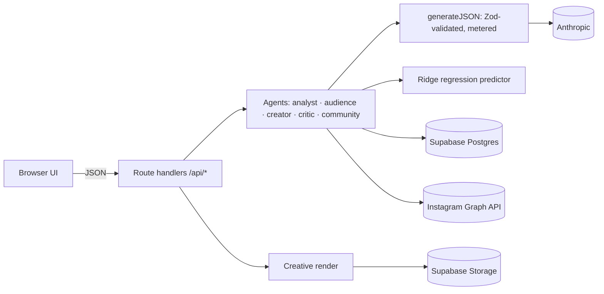

<p align="center"></p>

# Loopwise

**Live app:** https://loopwise-ruddy.vercel.app

Loopwise is a team of AI agents that relaunches and grows an Instagram account from its real audience data.
It builds personas from the account's demographics, writes posts and reels, tests them on a synthetic focus group and a model trained on the account's history, then learns from every result.

- Slides content: [docs/PITCH-SLIDES.md](docs/PITCH-SLIDES.md)
- Running the demo: [docs/LOCAL-DEMO.md](docs/LOCAL-DEMO.md)
- For judges and organizers: [docs/SUBMISSION.md](docs/SUBMISSION.md)

> The main demo runs locally (`npm run demo:build && npm run demo:start`); the production URL above is the backup.

**Predict before you post. Learn after you post.**

Loopwise is a team of AI agents that grows a brand on social media from its real Instagram data. It learns who the audience is from stats and comments, and writes posts and reels for that niche. Each idea is tested on a synthetic focus group and on an ML model trained on the account's own history. After posting, Loopwise learns from every result and drafts community replies and loyalty campaigns.

Built for ITFest × Adobe 2026 with Next.js 15, TypeScript, Supabase, Vercel and Anthropic.

- **Spec:** [docs/BLUEPRINT.md](docs/BLUEPRINT.md)
- **Technical pitch, with measured latency and cost:** [docs/PITCH-TECH.md](docs/PITCH-TECH.md)
- **Assistant instructions:** [CLAUDE.md](CLAUDE.md) (Fane) and [AGENTS.md](AGENTS.md) (Madalin). File ownership is in BLUEPRINT §3.

## Setup

Requires Node 22 or newer.

1. Install dependencies:
   ```bash
   npm install
   ```
2. Create your env file:
   ```bash
   cp .env.example .env.local
   ```
   Real values are shared privately, never through Git. Without values, the AI, Instagram and publishing modes default to `mock`.
3. Create the database: in the Supabase SQL Editor, run the files in [supabase/migrations](supabase/migrations) in order.
4. Start the app:
   ```bash
   npm run dev
   ```
   Then check <http://localhost:3000/api/health>; it should report `db: true`.

## Scripts

| Command | Purpose |
|---|---|
| `npm run dev` / `npm run build` | Dev server / production build |
| `npm run lint`, `npx tsc --noEmit`, `npm test` | Lint, typecheck, unit tests |
| `npx tsx scripts/smoke.ts` | End-to-end API check, PASS/FAIL per step; set `BASE_URL` to target a deployment |
| `node --env-file=.env.local --import tsx scripts/seed.ts` | Demo brand with 40 seeded posts, no LLM calls (fallback if Instagram is unavailable) |
| `node --env-file=.env.local --import tsx scripts/ig-snapshot.ts` | Caches a live Instagram snapshot to `data/ig-snapshot.json` (gitignored) |
| `node --env-file=.env.local --import tsx scripts/prepare-demo.ts` | Prepares the demo: brand, learnings, a ready campaign and community insights; prints the ids |

`smoke.ts` and `prepare-demo.ts` create data in the target database, and spend tokens when `AI_PROVIDER=anthropic`.

## Architecture



- **Where the code lives:**
  - `src/lib/core`: agent pipelines
  - `src/lib/ai`: LLM client, prompts and fixtures
  - `src/lib/ml`: features, regression and simulator
  - `src/lib/db`: data access, the only place that maps rows to contracts
- **API contracts:** all of them are in `src/lib/contracts.ts`.

## UI components

`src/components/ui` uses the shadcn `base-nova` style, built on Base UI rather than Radix. Compose triggers with the `render` prop instead of `asChild`.
