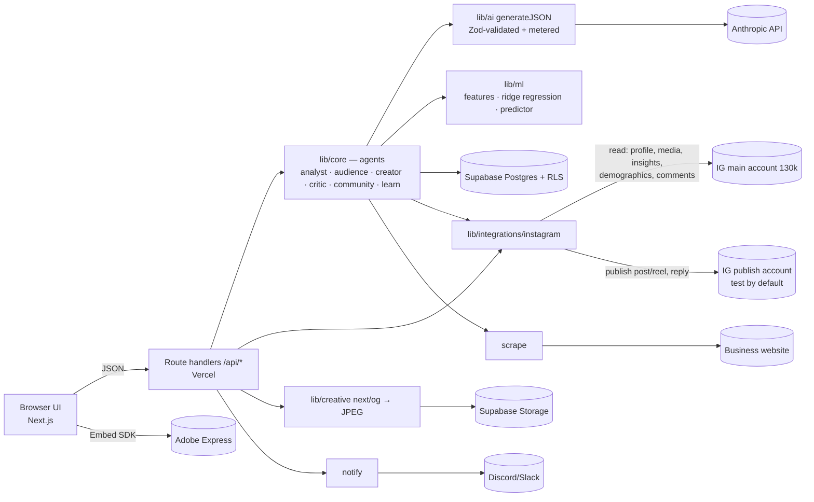

# LOOPWISE — Hackathon Blueprint v2 (ITFest × Adobe, 7 Nov 2026)

> **"Predict before you post. Learn after you post."**
> A team of AI agents that grows a brand on social media using **real account data**: it learns the audience from real Instagram stats and comments, creates posts and **reels** for a specific niche and audience, tests every idea on a **synthetic focus group** and an **ML model trained on the account's own history**, publishes, then **learns from every post/reel** and runs **loyalty/community** actions to keep followers engaged.

Validated live on a **real 130k-follower Instagram account** (@ironcladwind). Target market: small businesses (cafés, shops, local services) and creators in highly competitive niches.

This document is the single source of truth for both AI assistants (Claude Code for Fane, Codex for Madalin). If a chat instruction conflicts with it, ask the human.

---

## 0. Constraints & timeline

- Work window **08:00–20:00**; code freeze **18:30**; judging from 20:00.
- **Fane**: Claude Code — backend, AI agents, ML, data pipeline; owns shared config and contracts.
- **Madalin**: Codex orchestrator (+ OpenCode/Antigravity delegation) on Windows 11 — frontend, Instagram/Meta client, creative, Adobe, demo.
- AI quotas are limited → small, fully specified tasks; no repo exploration.
- The **app itself** uses the Anthropic API (key in `.env.local` and in Vercel env, never committed).

### Judging weights → what we optimise

| Criterion | Weight | How Loopwise scores it |
|---|---|---|
| Problem identification | 25% | Small businesses drown in competition; generic AI content doesn't build an audience. Real need: niche-specific audiences + testing before spending effort |
| AI-driven innovation | 25% | 5 cooperating agents (Analyst, Audience, Creator, Critic, Community); synthetic focus group; ML predictor trained on real account data; closed learning loop |
| Technical excellence | 25% | Typed Zod contracts, Postgres schema with RLS, tested ML, idempotent data import, metered AI costs, fallbacks, Vercel deploy |
| Third-party integrations | 15% | Instagram Graph API (profile, media, insights, demographics, comments, replies, publishing posts/reels), Facebook Page (optional), Adobe Express Embed SDK, Discord/Slack, website ingestion |
| Product experience / demo | 10% | Live demo on a real 130k account, polished UI, recorded fallback |
| **Bonus: cost vs value** | **+10%** | Every AI call metered (tokens → €); ROI meter per campaign; unit economics per plan (§11) |

---

## 1. Concept & MVP

### Problem
- Social media (Instagram, TikTok, Facebook) is now the main storefront for small businesses and creators, and **short video (reels) dominates reach**.
- Competition is brutal: a café competes with every café in town *and* every creator in its niche. Without a **specific audience** and **systematic content testing**, posts disappear.
- Small teams can't afford a marketing agency. Today's AI tools only **generate** generic content: they don't know the real audience, can't predict what works, and never learn from results ("generate and pray").

### Target users
SMB owners and solo marketers (cafés, shops, local services) and creators with 1–3 accounts; later, small agencies (multi-brand tier).

### Solution — five AI agents in one loop

| Agent | What it does | Data |
|---|---|---|
| **Analyst** | Imports the account's real posts/reels, insights and audience demographics; trains the performance model; finds best formats and posting hours | Instagram Graph API |
| **Audience** | Builds 4 data-grounded personas (age/gender/city split, interests, what they praise/ask/complain about in comments) and defines the niche + content pillars | Demographics + comments + top posts |
| **Creator** | Generates campaign variants per format: post, carousel, **reel (hook, scene-by-scene script, on-screen text, audio direction, cover text, editing notes)**, story; repurposing notes for TikTok | Brand DNA + personas + learnings |
| **Critic** | Synthetic focus group (every persona reacts to every variant) + ML predicted engagement → ranking and winner | Personas + model |
| **Community** | Reads real comments, classifies sentiment/topic, drafts on-brand replies (human approves, sent via API), and proposes **loyalty campaigns** (series, Q&A, challenges/UGC, giveaways, reply-to-comment reels) | Comments + Brand DNA |

Loop: **Import real data → Understand audience → Create → Test (focus group + ML) → Publish → Measure → Learn → Engage community → repeat.** Every post/reel makes the next one better.

### MVP (MUST — demo works with these)
Instagram import (real data) → Brand DNA + audience profile + personas → campaign with post/reel variants → focus group + prediction + ranking → creative render → publish (to a safe test account or mock) → metrics → learning loop on real history → new campaign applies learnings → ROI meter.

### SHOULD
Community agent with reply suggestions (+ send reply); analytics dashboard; website-based onboarding for businesses without data; Discord notification; Adobe Express editing; landing page with ROI calculator.

### OPTIONAL
Reel publishing from an uploaded video; Facebook Page publishing; competitor scan (`business_discovery`).

### Cut order if behind schedule (cut from the top)
1. Landing page (keep the ROI calculator inside Analytics) → 2. Facebook publishing → 3. Website onboarding → 4. Community "send reply" (keep the suggestions) → 5. Discord → 6. Adobe Express. **Never cut**: IG import, personas, Creator, Critic, learning loop, ROI meter.

### Monetisation
Starter **€19/mo** (1 account, 20 campaigns), Growth **€49/mo** (3 accounts, community agent, learning loop), Agency **€149/mo** (unlimited accounts, client reports). See §11 for cost vs value.

### Data ethics rules (also a pitch point)
- Live data comes from the account owner's own authorised token; nothing is scraped from Instagram.
- Commenter usernames are never sent to the LLM; comments are sent as text only. No personal data is stored beyond what the feature needs.
- Simulated/seeded numbers are always labelled `source: "simulated" | "seeded"` in the UI.
- **Nothing is ever posted to the 130k account without Fane explicitly choosing it.** By default, publishing goes to a separate test account (§4.4).

---

## 2. Architecture



- One **Next.js 15** app (App Router, TypeScript, `src/`), deployed on **Vercel**.
- **DB access server-side only** with the Supabase service role key; RLS on with no policies. No user auth in MVP (single workspace).
- **All LLM outputs validated with Zod**, one retry on failure, each call metered into `ai_usage`.
- Fallback modes via env: `AI_PROVIDER=mock`, `PUBLISH_MODE=mock`, `IG_DATA_MODE=mock` (uses a saved snapshot), `NEXT_PUBLIC_USE_MOCKS=true` (UI fixtures).
- Long routes: `export const maxDuration = 60;`.

### Tech stack (fixed — no new dependencies without asking Fane)
`next@15`, `react@19`, `typescript`, `tailwindcss`, shadcn/ui (pre-added in F0), `lucide-react`, `recharts`, `sonner`, `zod`, `@supabase/supabase-js`, `cheerio`, `sharp`, `@anthropic-ai/sdk`; dev: `vitest`, `tsx`, `eslint`. npm, Node ≥ 20.

---

## 3. Repository structure & file ownership

**F** = Fane only, **M** = Madalin only. Never edit a file you don't own.

```
loopwise/
├─ AGENTS.md  CLAUDE.md  docs/BLUEPRINT.md  README.md        F
├─ .env.example .gitattributes .gitignore                    F   (.gitignore includes .env*.local, data/*.json)
├─ package.json package-lock.json tsconfig.json next.config.ts
│  postcss/tailwind config components.json vitest.config.ts  F
├─ supabase/migrations/0001_init.sql                         F
├─ scripts/seed.ts  scripts/smoke.ts  scripts/ig-snapshot.ts F
├─ data/ig-snapshot.json   (gitignored local cache)          generated
└─ src/
   ├─ app/
   │  ├─ layout.tsx globals.css         F in F0 → M after C0
   │  ├─ page.tsx (landing + ROI calculator)                 M
   │  ├─ (app)/brands/page.tsx                               M
   │  ├─ (app)/brands/new/page.tsx  (Connect Instagram / website)  M
   │  ├─ (app)/brands/[id]/page.tsx  (DNA, audience, personas, memory)  M
   │  ├─ (app)/brands/[id]/analytics/page.tsx                M
   │  ├─ (app)/brands/[id]/community/page.tsx                M
   │  ├─ (app)/brands/[id]/campaigns/new/page.tsx            M
   │  ├─ (app)/campaigns/[id]/page.tsx  (Studio)             M
   │  └─ api/
   │     ├─ health/route.ts                                  F
   │     ├─ brands/route.ts                    GET list      F
   │     ├─ brands/from-instagram/route.ts                   F
   │     ├─ brands/analyze/route.ts            website path  F
   │     ├─ brands/[id]/route.ts                             F
   │     ├─ brands/[id]/learn/route.ts                       F
   │     ├─ brands/[id]/dashboard/route.ts                   F
   │     ├─ brands/[id]/community/route.ts     GET + POST    F
   │     ├─ campaigns/route.ts                 GET + POST    F
   │     ├─ campaigns/[id]/route.ts                          F
   │     ├─ variants/[id]/render/route.ts                    M
   │     ├─ variants/[id]/publish/route.ts                   M
   │     ├─ creative/[id]/route.tsx                          M
   │     ├─ publications/[id]/simulate/route.ts              M
   │     └─ comments/[id]/reply/route.ts                     M
   ├─ components/ui/*      F (shadcn, frozen after F0)
   ├─ components/app/*     M
   └─ lib/
      ├─ contracts.ts env.ts supabase.ts http.ts             F
      ├─ ai/client.ts ai/prompts.ts ai/fixtures.ts           F
      ├─ core/scrape.ts brand.ts instagramBrand.ts campaign.ts
      │  community.ts learn.ts dashboard.ts costValue.ts     F
      ├─ ml/features.ts regression.ts predictor.ts simulate.ts *.test.ts  F
      ├─ db/brands.ts campaigns.ts learnings.ts model.ts usage.ts comments.ts imports.ts  F
      ├─ db/publications.ts metrics.ts creatives.ts          M
      ├─ integrations/instagram.ts notify.ts adobe-express.ts  M  (stubs created by F in F0)
      ├─ creative/render.tsx                                 M
      ├─ api-client.ts                                       M
      └─ mock/fixtures.ts                                    M
```

Cross-owner imports are allowed (calling a function), editing is not. Key handshake: **Fane's pipeline calls `fetchInstagramSnapshot()` from Madalin's `instagram.ts`**; the shape it returns is the `IgSnapshot` contract below. Until Madalin implements it, the F0 stub returns the mock snapshot fixture.

---

## 4. Contracts

### 4.1 `src/lib/contracts.ts` (create exactly this in F0)

```ts
import { z } from "zod";

export const Platform = z.enum(["instagram", "facebook"]);
export const Format = z.enum(["post", "carousel", "reel", "story"]);
export const Goal = z.enum(["awareness", "engagement", "followers", "traffic", "conversions", "loyalty"]);
const uuid = z.string().uuid();
const share = z.number().min(0).max(1);

// ---------- Instagram snapshot (returned by lib/integrations/instagram.ts) ----------
export const IgMedia = z.object({
  id: z.string(),
  caption: z.string().nullable(),
  mediaType: z.enum(["IMAGE", "VIDEO", "CAROUSEL_ALBUM"]),
  mediaProductType: z.string().nullable(),   // "REELS" | "FEED" | "STORY" | ...
  permalink: z.string().url().nullable(),
  thumbnailUrl: z.string().url().nullable(),
  timestamp: z.string(),
  likeCount: z.number().int().nullable(),
  commentsCount: z.number().int().nullable(),
  insights: z.object({
    reach: z.number().int().nullable(),
    views: z.number().int().nullable(),
    saved: z.number().int().nullable(),
    shares: z.number().int().nullable(),
    totalInteractions: z.number().int().nullable(),
  }).nullable(),
});
export const IgComment = z.object({
  id: z.string(),
  mediaId: z.string(),
  text: z.string(),
  likeCount: z.number().int().nullable(),
  timestamp: z.string(),
  // username deliberately NOT included (privacy)
});
export const Demographics = z.object({
  ageGender: z.array(z.object({ bucket: z.string(), share })),   // e.g. "F.25-34"
  topCities: z.array(z.object({ name: z.string(), share })),
  topCountries: z.array(z.object({ name: z.string(), share })),
});
export const IgSnapshot = z.object({
  profile: z.object({
    id: z.string(),
    username: z.string(),
    name: z.string().nullable(),
    biography: z.string().nullable(),
    website: z.string().nullable(),
    followers: z.number().int(),
    mediaCount: z.number().int(),
  }),
  media: z.array(IgMedia),          // newest first, up to the requested limit
  comments: z.array(IgComment),     // recent comments on the top media
  demographics: Demographics.nullable(),
  onlineHours: z.array(z.number()).length(24).nullable(), // avg followers online per hour (local)
  fetchedAt: z.string(),
  mode: z.enum(["live", "mock"]),
});

// ---------- Brand ----------
export const BrandDNA = z.object({
  summary: z.string(),
  niche: z.string(),                         // specific, e.g. "budget home workouts for busy dads"
  industry: z.string(),
  valueProposition: z.string(),
  toneOfVoice: z.array(z.string()).min(1),
  doList: z.array(z.string()),
  dontList: z.array(z.string()),
  contentPillars: z.array(z.string()).min(2).max(6),
  products: z.array(z.string()),
  targetAudience: z.string(),
  colors: z.array(z.string().regex(/^#[0-9a-fA-F]{6}$/)).min(2).max(5),
  keywords: z.array(z.string()),
});

export const AudienceProfile = z.object({
  followers: z.number().int(),
  demographics: Demographics.nullable(),
  bestHours: z.array(z.number().int().min(0).max(23)).max(4),
  formatPerformance: z.array(z.object({        // computed from real data, not by the LLM
    format: Format, posts: z.number().int(), avgEngagementRate: z.number(),
  })),
  pillarPerformance: z.array(z.object({        // LLM tags posts to pillars, numbers computed in code
    pillar: z.string(), posts: z.number().int(), avgEngagementRate: z.number(),
  })),
  audienceVoice: z.object({
    topics: z.array(z.string()), praise: z.array(z.string()),
    complaints: z.array(z.string()), questions: z.array(z.string()),
  }).nullable(),
  updatedAt: z.string(),
});

export const Persona = z.object({
  id: uuid, brandId: uuid,
  name: z.string(), ageRange: z.string(), gender: z.string().nullable(), location: z.string().nullable(),
  description: z.string(),
  motivations: z.array(z.string()), painPoints: z.array(z.string()),
  contentTheyLove: z.array(z.string()),
  preferredFormat: Format,
  segmentShare: share,                    // shares sum to ~1 per brand
  groundedIn: z.string(),                 // which real data supports this persona
});

export const Learning = z.object({
  id: uuid, brandId: uuid,
  insight: z.string(), evidence: z.string(),
  confidence: z.enum(["low", "medium", "high"]),
  createdAt: z.string(),
});

export const Brand = z.object({
  id: uuid,
  name: z.string(),
  websiteUrl: z.string().url().nullable(),
  instagram: z.object({ userId: z.string(), username: z.string(), followers: z.number().int() }).nullable(),
  dna: BrandDNA,
  audience: AudienceProfile.nullable(),
  createdAt: z.string(),
});
export const BrandWithContext = Brand.extend({
  personas: z.array(Persona),
  learnings: z.array(Learning),
  importedPosts: z.number().int(),
});

// ---------- Content ----------
export const ReelScript = z.object({
  hook: z.string(),                       // first 1–2 seconds, on-screen + spoken
  durationSeconds: z.number().int().min(5).max(90),
  scenes: z.array(z.object({
    seconds: z.string(),                  // "0-2"
    visual: z.string(), onScreenText: z.string(), voiceover: z.string().nullable(),
  })).min(2).max(10),
  audioDirection: z.string(),             // mood/tempo, e.g. "upbeat trending-style beat, 120bpm"
  coverText: z.string(),
  editingNotes: z.array(z.string()),      // cuts, captions, zooms, transitions (Adobe Express-friendly)
  tiktokRepurpose: z.string(),            // what to change for TikTok
});

export const PersonaReaction = z.object({
  personaId: uuid, personaName: z.string(),
  stopScore: z.number().min(0).max(10),
  sentiment: z.enum(["positive", "neutral", "negative"]),
  quote: z.string(), objection: z.string().nullable(),
});

export const Variant = z.object({
  id: uuid, campaignId: uuid,
  origin: z.enum(["generated", "imported"]),
  format: Format,
  angle: z.string(),
  caption: z.string(),
  hashtags: z.array(z.string()),
  cta: z.string(),
  imageHeadline: z.string(),
  imagePrompt: z.string(),
  imageUrl: z.string().url().nullable(),
  reelScript: ReelScript.nullable(),      // required when format = "reel"
  suggestedPostHour: z.number().int().min(0).max(23).nullable(),
  panel: z.array(PersonaReaction),
  panelScore: z.number().min(0).max(100).nullable(),             // null for imported
  predictedEngagementRate: z.number().min(0).max(1).nullable(),  // null for imported
  rank: z.number().int().min(1),
  status: z.enum(["draft", "approved", "published"]),
  appliedLearningIds: z.array(uuid),
});

export const AICost = z.object({
  inputTokens: z.number().int(), outputTokens: z.number().int(),
  costEur: z.number(), estimated: z.boolean(),
});

export const Campaign = z.object({
  id: uuid, brandId: uuid,
  kind: z.enum(["generated", "imported_history"]),
  goal: Goal, platform: Platform, brief: z.string(),
  formats: z.array(Format),
  status: z.enum(["generating", "ready", "published", "failed"]),
  createdAt: z.string(),
  variants: z.array(Variant),             // generated: sorted by rank
  aiCost: AICost,
});

// ---------- Results ----------
export const Publication = z.object({
  id: uuid, variantId: uuid, platform: Platform,
  mode: z.enum(["live", "mock", "imported"]),
  account: z.enum(["main", "publish"]),
  externalId: z.string().nullable(), permalink: z.string().url().nullable(),
  status: z.enum(["published", "failed"]), error: z.string().nullable(),
  publishedAt: z.string(),
});

export const Metrics = z.object({
  id: uuid, publicationId: uuid,
  reach: z.number().int(), views: z.number().int(),
  likes: z.number().int(), comments: z.number().int(),
  shares: z.number().int(), saves: z.number().int(),
  engagementRate: z.number().min(0).max(1),  // (likes+comments+shares+saves)/max(reach,1)
  source: z.enum(["live", "seeded", "simulated"]),
  capturedAt: z.string(),
});

export const ModelState = z.object({
  weights: z.record(z.string(), z.number()),
  r2: z.number().nullable(), samples: z.number().int(),
  trainedOn: z.enum(["live", "seeded", "mixed"]),
  updatedAt: z.string(),
});

export const CommentInsight = z.object({
  id: uuid, brandId: uuid, externalId: z.string(), mediaExternalId: z.string(),
  text: z.string(),
  sentiment: z.enum(["positive", "neutral", "negative"]).nullable(),
  topic: z.string().nullable(),
  isQuestion: z.boolean().nullable(),
  suggestedReply: z.string().nullable(),
  replied: z.boolean(),
  createdAt: z.string(),
});

export const Community = z.object({
  brandId: uuid,
  comments: z.array(CommentInsight),     // newest first, max 50
  summary: z.object({
    positiveShare: z.number(), negativeShare: z.number(), questionShare: z.number(),
    topTopics: z.array(z.string()),
  }).nullable(),
  loyaltyIdeas: z.array(z.object({
    title: z.string(),
    mechanic: z.enum(["series", "qna", "challenge_ugc", "giveaway", "reply_reel", "behind_scenes", "poll_story"]),
    description: z.string(), why: z.string(),
  })),
});

export const CostValue = z.object({
  aiCostEur: z.number(), costPerCampaignEur: z.number(), campaigns: z.number().int(),
  minutesSaved: z.number(), valueEur: z.number(), roiMultiple: z.number(),
  assumptions: z.object({
    hourlyRateEur: z.number(), minutesSavedPerCampaign: z.number(),
    priceInputEurPerMTok: z.number(), priceOutputEurPerMTok: z.number(),
  }),
});

export const Dashboard = z.object({
  brandId: uuid,
  totals: z.object({
    posts: z.number().int(), reach: z.number().int(), avgEngagementRate: z.number(),
  }),
  series: z.array(z.object({
    date: z.string(), actual: z.number(), predicted: z.number().nullable(),
    variantId: uuid, format: Format, source: Metrics.shape.source,
  })),
  topPosts: z.array(z.object({
    variantId: uuid, caption: z.string(), format: Format,
    imageUrl: z.string().url().nullable(), permalink: z.string().url().nullable(),
    engagementRate: z.number(), source: Metrics.shape.source,
  })),
  model: ModelState.nullable(),
  costValue: CostValue,
});

// ---------- Requests ----------
export const FromInstagramRequest = z.object({ limit: z.number().int().min(10).max(100).default(50) });
export const AnalyzeBrandRequest = z.object({
  name: z.string().min(1), url: z.string().url().optional(), description: z.string().optional(),
}).refine(r => r.url || r.description, { message: "url or description required" });
export const CreateCampaignRequest = z.object({
  brandId: uuid, goal: Goal, platform: Platform, brief: z.string().min(5),
  formats: z.array(Format).min(1).default(["reel", "post"]),
  variantCount: z.number().int().min(2).max(5).default(4),
});
export const PublishRequest = z.object({
  platform: Platform,
  account: z.enum(["main", "publish"]).default("publish"),
  confirmMainAccount: z.boolean().optional(),   // must be true to post to the 130k account
});
export const ReplyRequest = z.object({ text: z.string().min(1).max(500) });
export const ApiError = z.object({ error: z.object({ code: z.string(), message: z.string() }) });

// ---------- Types ----------
export type TIgSnapshot = z.infer<typeof IgSnapshot>;
export type TIgMedia = z.infer<typeof IgMedia>;
export type TBrandDNA = z.infer<typeof BrandDNA>;
export type TAudienceProfile = z.infer<typeof AudienceProfile>;
export type TPersona = z.infer<typeof Persona>;
export type TLearning = z.infer<typeof Learning>;
export type TBrand = z.infer<typeof Brand>;
export type TBrandWithContext = z.infer<typeof BrandWithContext>;
export type TReelScript = z.infer<typeof ReelScript>;
export type TPersonaReaction = z.infer<typeof PersonaReaction>;
export type TVariant = z.infer<typeof Variant>;
export type TCampaign = z.infer<typeof Campaign>;
export type TPublication = z.infer<typeof Publication>;
export type TMetrics = z.infer<typeof Metrics>;
export type TModelState = z.infer<typeof ModelState>;
export type TCommentInsight = z.infer<typeof CommentInsight>;
export type TCommunity = z.infer<typeof Community>;
export type TAICost = z.infer<typeof AICost>;
export type TCostValue = z.infer<typeof CostValue>;
export type TDashboard = z.infer<typeof Dashboard>;
export type TCreateCampaignRequest = z.infer<typeof CreateCampaignRequest>;
export type TAnalyzeBrandRequest = z.infer<typeof AnalyzeBrandRequest>;
```

### 4.2 API endpoints

Success → JSON object (200/201). Error → `ApiError` with 400 / 404 / 422 / 502 (upstream AI or Instagram) / 500, via `ok()` / `fail()` in `lib/http.ts`.

| Method & path | Owner | Body | Response | Notes |
|---|---|---|---|---|
| GET `/api/health` | F | – | `{ok, db, aiProvider, publishMode, igDataMode}` | |
| GET `/api/brands` | F | – | `TBrand[]` | |
| POST `/api/brands/from-instagram` | F | `FromInstagramRequest` | `TBrandWithContext` (201) | **Analyst + Audience agents**; idempotent (upsert by IG user id) → also the "Refresh data" action |
| POST `/api/brands/analyze` | F | `AnalyzeBrandRequest` | `TBrandWithContext` (201) | website path for businesses without IG data (SHOULD) |
| GET `/api/brands/:id` | F | – | `TBrandWithContext` | |
| POST `/api/brands/:id/learn` | F | – | `{learnings: TLearning[], model: TModelState}` | |
| GET `/api/brands/:id/dashboard` | F | – | `TDashboard` | |
| GET `/api/brands/:id/community` | F | – | `TCommunity` | from DB |
| POST `/api/brands/:id/community` | F | – | `TCommunity` | **Community agent**: classify unprocessed comments + replies + loyalty ideas |
| POST `/api/campaigns` | F | `CreateCampaignRequest` | `TCampaign` (201) | **Creator + Critic agents**; calls `notifyCampaignReady` |
| GET `/api/campaigns?brandId=` | F | – | `TCampaign[]` (variants may be empty) | |
| GET `/api/campaigns/:id` | F | – | `TCampaign` | |
| POST `/api/variants/:id/render` | M | `{imageBase64?: string}` | `{imageUrl}` | renders (or stores the Adobe-edited image) as JPEG |
| GET `/api/creative/:id` | M | – | `image/png` | live preview |
| POST `/api/variants/:id/publish` | M | `PublishRequest` | `TPublication` (201) | refuses `account:"main"` unless `confirmMainAccount: true` |
| POST `/api/publications/:id/simulate` | M | – | `TMetrics` | uses `simulateMetrics()` |
| POST `/api/comments/:id/reply` | M | `ReplyRequest` | `{ok: true, externalId}` | sends via IG API (main account), marks replied |

### 4.3 Database — `supabase/migrations/0001_init.sql`

```sql
create extension if not exists pgcrypto;

create table brands (
  id uuid primary key default gen_random_uuid(),
  name text not null,
  website_url text,
  ig_user_id text unique,
  ig_username text,
  followers int,
  dna jsonb not null,
  audience jsonb,
  created_at timestamptz not null default now()
);

create table personas (
  id uuid primary key default gen_random_uuid(),
  brand_id uuid not null references brands(id) on delete cascade,
  name text not null, age_range text not null, gender text, location text,
  description text not null,
  motivations jsonb not null default '[]',
  pain_points jsonb not null default '[]',
  content_they_love jsonb not null default '[]',
  preferred_format text not null,
  segment_share numeric not null default 0.25,
  grounded_in text not null default ''
);

create table campaigns (
  id uuid primary key default gen_random_uuid(),
  brand_id uuid not null references brands(id) on delete cascade,
  kind text not null default 'generated' check (kind in ('generated','imported_history')),
  goal text not null,
  platform text not null check (platform in ('instagram','facebook')),
  brief text not null,
  formats text[] not null default '{}',
  status text not null default 'generating',
  created_at timestamptz not null default now()
);

create table variants (
  id uuid primary key default gen_random_uuid(),
  campaign_id uuid not null references campaigns(id) on delete cascade,
  origin text not null default 'generated' check (origin in ('generated','imported')),
  format text not null,
  angle text not null default '',
  caption text not null default '',
  hashtags text[] not null default '{}',
  cta text not null default '',
  image_headline text not null default '',
  image_prompt text not null default '',
  image_url text,
  reel_script jsonb,
  suggested_post_hour int,
  panel jsonb not null default '[]',
  panel_score numeric,
  predicted_engagement_rate numeric,
  rank int not null default 1,
  status text not null default 'draft',
  applied_learning_ids uuid[] not null default '{}',
  created_at timestamptz not null default now()
);

create table publications (
  id uuid primary key default gen_random_uuid(),
  variant_id uuid not null references variants(id) on delete cascade,
  platform text not null,
  mode text not null check (mode in ('live','mock','imported')),
  account text not null default 'publish' check (account in ('main','publish')),
  external_id text unique,
  permalink text,
  status text not null,
  error text,
  published_at timestamptz not null default now()
);

create table metrics (
  id uuid primary key default gen_random_uuid(),
  publication_id uuid not null references publications(id) on delete cascade,
  reach int not null default 0, views int not null default 0,
  likes int not null default 0, comments int not null default 0,
  shares int not null default 0, saves int not null default 0,
  engagement_rate numeric not null default 0,
  source text not null check (source in ('live','seeded','simulated')),
  captured_at timestamptz not null default now()
);

create table comments (
  id uuid primary key default gen_random_uuid(),
  brand_id uuid not null references brands(id) on delete cascade,
  external_id text not null unique,
  media_external_id text not null,
  text text not null,
  like_count int,
  sentiment text, topic text, is_question boolean,
  suggested_reply text,
  replied boolean not null default false,
  created_at timestamptz not null default now()
);

create table learnings (
  id uuid primary key default gen_random_uuid(),
  brand_id uuid not null references brands(id) on delete cascade,
  insight text not null, evidence text not null,
  confidence text not null check (confidence in ('low','medium','high')),
  created_at timestamptz not null default now()
);

create table model_state (
  brand_id uuid primary key references brands(id) on delete cascade,
  weights jsonb not null, r2 numeric, samples int not null default 0,
  trained_on text not null default 'live',
  updated_at timestamptz not null default now()
);

create table loyalty_ideas (
  id uuid primary key default gen_random_uuid(),
  brand_id uuid not null references brands(id) on delete cascade,
  title text not null, mechanic text not null, description text not null, why text not null,
  created_at timestamptz not null default now()
);

create table ai_usage (
  id uuid primary key default gen_random_uuid(),
  brand_id uuid references brands(id) on delete cascade,
  campaign_id uuid references campaigns(id) on delete cascade,
  operation text not null,
  provider text not null,
  input_tokens int not null default 0,
  output_tokens int not null default 0,
  cost_eur numeric not null default 0,
  estimated boolean not null default false,
  latency_ms int,
  created_at timestamptz not null default now()
);

create index on personas(brand_id);
create index on campaigns(brand_id);
create index on variants(campaign_id);
create index on publications(variant_id);
create index on metrics(publication_id);
create index on comments(brand_id);
create index on learnings(brand_id);
create index on loyalty_ideas(brand_id);
create index on ai_usage(brand_id);
create index on ai_usage(campaign_id);

do $$ declare t text; begin
  foreach t in array array['brands','personas','campaigns','variants','publications','metrics',
    'comments','learnings','model_state','loyalty_ideas','ai_usage'] loop
    execute format('alter table %I enable row level security', t);
  end loop;
end $$;
-- No policies on purpose: only the server (service role) accesses data.

insert into storage.buckets (id, name, public) values ('creatives','creatives', true)
on conflict (id) do nothing;
```

Row ↔ contract mapping (snake_case ↔ camelCase) happens only inside `lib/db/*.ts`. Never return raw rows.

### 4.4 Environment variables (`.env.example`; real values in `.env.local` + Vercel)

```
# AI
AI_PROVIDER=anthropic              # anthropic | mock
ANTHROPIC_API_KEY=
ANTHROPIC_MODEL=claude-sonnet-5-5

# Cost vs value (set prices from the provider's CURRENT pricing page)
AI_PRICE_INPUT_EUR_PER_MTOK=3
AI_PRICE_OUTPUT_EUR_PER_MTOK=14
VALUE_HOURLY_RATE_EUR=20
VALUE_MINUTES_SAVED_PER_CAMPAIGN=120

# Supabase (server only)
SUPABASE_URL=
SUPABASE_SERVICE_ROLE_KEY=

# Instagram — Instagram API with Instagram Login (graph.instagram.com)
IG_DATA_MODE=live                  # live | mock (mock reads data/ig-snapshot.json or the fixture)
IG_API_VERSION=                    # current version from Meta docs, e.g. vXX.0
IG_MAIN_USER_ID=                   # the 130k account: READ data + reply to comments
IG_MAIN_ACCESS_TOKEN=
IG_PUBLISH_USER_ID=                # test account used for publishing in the demo
IG_PUBLISH_ACCESS_TOKEN=
PUBLISH_MODE=mock                  # live | mock

# Facebook Page (OPTIONAL)
FB_PAGE_ID=
FB_PAGE_ACCESS_TOKEN=

# Notifications
DISCORD_WEBHOOK_URL=
SLACK_WEBHOOK_URL=

# Adobe Express Embed SDK
NEXT_PUBLIC_ADOBE_CLIENT_ID=

# App
NEXT_PUBLIC_APP_URL=http://localhost:3000
NEXT_PUBLIC_USE_MOCKS=false
```

Next.js reads **`.env.local`** (not `.env`) and it is gitignored. Secrets are shared between teammates privately, never through Git.

---

## 5. AI agents & ML (Fane's core)

### 5.1 `lib/ai/client.ts`
```ts
export async function generateJSON<T>(opts: {
  system: string; prompt: string; schema: z.ZodType<T>;
  temperature?: number;      // default 0.7; 0.3 for analysis/classification
  maxTokens?: number;        // default 4000
  fixture: string;           // key in ai/fixtures.ts for AI_PROVIDER=mock
  usage: { operation: string; brandId?: string; campaignId?: string };
}): Promise<T>
```
- JSON-only output; strip ``` fences; `JSON.parse` → `schema.parse`; one retry with the validation error; then throw `AIError`. 50 s timeout.
- **Metering**: insert an `ai_usage` row with the reported tokens and `cost_eur = in/1e6·PRICE_IN + out/1e6·PRICE_OUT`; mock → tokens ≈ chars/4, `estimated = true`. A metering failure never fails the call.
- Mock provider returns fixtures after 800 ms.

### 5.2 Agent prompts (`lib/ai/prompts.ts`, English, JSON output, write content in the account's language)

1. **audienceAgent** (op `audienceAnalysis`) — input: profile (bio, followers), top 15 + bottom 10 posts (caption ≤ 300 chars, format, ER), demographics, best hours, 60 comment texts. Output: `{dna: BrandDNA, pillarTags: [{mediaId, pillar}], audienceVoice: {...}, personas: [4 × persona fields + groundedIn]}`. Rules: niche must be **specific**; personas must match the demographic split (segmentShare ≈ demographic shares) and cite the data in `groundedIn`; no invented statistics.
2. **websiteAgent** (op `brandAnalysis`) — website text (≤ 6 000 chars) or description → `{dna, personas}` (no real data → `groundedIn: "website + assumptions"`).
3. **creatorAgent** (op `campaignVariants`) — DNA, audience profile, personas, latest 6 learnings (id + text), goal, formats, platform, brief, n. Output: `{variants: [n × {format, angle, caption, hashtags, cta, imageHeadline, imagePrompt, reelScript|null, suggestedPostHour, appliedLearningIds}]}`. Rules: spread formats over the requested list (prefer **reel** when it performs best in `formatPerformance`); distinct angles; reels must have a hook in the first 2 seconds, 3–8 scenes, on-screen text, editing notes usable in Adobe Express, and a TikTok repurpose note; follow do/don't; `suggestedPostHour` from bestHours; **goal = loyalty** → use mechanics (series, Q&A, UGC challenge, giveaway, reply-to-comment reel); list only learnings actually applied.
4. **criticAgent** (op `focusGroup`) — personas + variants → `{reactions: [{variantIndex, personaId, stopScore, sentiment, quote, objection}]}` for every persona × variant in **one** call. Rules: in character, critical, full 0–10 range, reels judged on the hook.
5. **learningAgent** (op `learningInsights`) — table of posts (format, pillar, caption length, hashtags, hour, question/emoji flags, actual ER, predicted ER) + model weights with feature names + audienceVoice → `{learnings: [3–5 × {insight, evidence, confidence}]}`. Every insight cites numbers from the table.
6. **communityAgent** (op `communityAnalysis`) — DNA + up to 40 unprocessed comments (id + text only) → `{comments: [{id, sentiment, topic, isQuestion, suggestedReply}], loyaltyIdeas: [3 × {...}]}`. Replies: short, warm, on-brand, answer questions, never promise discounts/prices not in the DNA.

### 5.3 Pipelines (`lib/core/*`)
- **instagramBrand.ts `buildBrandFromInstagram(limit)`**
  1. `snapshot = await fetchInstagramSnapshot({limit})` (Madalin's module; validate with `IgSnapshot.parse`).
  2. Upsert the brand by `ig_user_id`; upsert an `imported_history` campaign; for each media upsert variant (`origin: imported`, `format` from mediaType/productType: REELS → reel, CAROUSEL_ALBUM → carousel, else post; caption; hashtags parsed from the caption) + publication (`mode: imported`, `account: main`, `external_id` unique, `published_at` = timestamp) + latest metrics (`source: live`; ER = (likes+comments+shares+saved)/max(reach,1); if insights are missing use likeCount/commentsCount with reach = null → skip from training). Upsert comments (`lib/db/comments.ts`).
  3. Compute in code: `formatPerformance`, `bestHours` (top 3 from onlineHours, else from the hours of top-ER posts).
  4. Call **audienceAgent**; compute `pillarPerformance` from `pillarTags` + real ER; save `dna`, `audience`; replace personas.
  5. Fit the model on the imported data (`trainedOn: "live"`) if ≥ 8 samples.
  6. Return `BrandWithContext`.
- **brand.ts `analyzeBrandFromWebsite(req)`** — scrape → websiteAgent → persist (audience null).
- **campaign.ts `createCampaign(req)`** — insert campaign → creatorAgent → criticAgent → `panelScore = Σ share·stopScore·10` → features → predict → rank by `0.5·norm(panel) + 0.5·norm(predicted)` → insert variants → `ready` → `notifyCampaignReady` (fire-and-forget) → return with `aiCost`. On error → `failed`, rethrow.
- **learn.ts `runLearning(brandId)`** — all variants with metrics → fit (trainedOn live/seeded/mixed) → learningAgent → insert learnings → return.
- **community.ts** — `getCommunity(brandId)` from DB; `runCommunityAgent(brandId)` processes unprocessed comments (max 40), saves results + loyalty ideas, returns `TCommunity`.
- **dashboard.ts** + **costValue.ts** — totals, series (ordered by date), top 5 posts, model, cost/value.

### 5.4 ML (`lib/ml/*`)
- **features.ts** `extractFeatures({caption, hashtags, panelScore, format, postHour})` → `[1, (panelScore ?? 50)/100, min(len,600)/600, hashtags/10, hasQuestion, hasEmoji, hashtags>10, format==="reel", format==="carousel", postHour in 17..22]` + `FEATURE_NAMES`.
- **regression.ts** ridge regression `(XᵀX + λI)⁻¹Xᵀy`, λ = 0.1, Gaussian elimination, `r2()`; target = `log(ER + 0.001)` (ER is skewed), predict back with `exp(·) − 0.001`.
- **predictor.ts** `DEFAULT_WEIGHTS`, `predict()` clamped to [0.002, 0.30], `fit(samples)` → `ModelState` (≥ 8 samples, else defaults).
- **simulate.ts** `simulateMetrics(v, seed?)` — hidden ground truth (base ER 3%; question ×1.3; caption < 150 ×1.2; 3–6 hashtags ×1.1; > 10 ×0.75; emoji ×1.1; reel ×1.5; carousel ×1.2; evening ×1.1; panel factor `0.6 + 0.8·panel/100`; ±15% noise; reach 2 000–20 000). Used by the seed fallback and `/simulate`.
- **Tests** (vitest): regression recovers known weights (R² > 0.9), predict clamps, features deterministic, simulate deterministic with a seed.

### 5.5 Seed fallback (`scripts/seed.ts`)
Only used if the Instagram API is unavailable: creates a demo brand with hard-coded DNA/audience/personas and 40 imported-style posts with `source: "seeded"` metrics from `simulateMetrics`. Idempotent.

### 5.6 Snapshot cache (`scripts/ig-snapshot.ts`)
Calls `fetchInstagramSnapshot({limit: 50})` with live credentials and writes `data/ig-snapshot.json` (gitignored). With `IG_DATA_MODE=mock`, `instagram.ts` reads this file (falling back to the fixture). Run it as soon as the live import works → demo-proof fallback with real data.

---

## 6. Task boards

Every task ends with: lint + typecheck + build pass, PR opened, report (§8). Effort is AI-assisted wall time.

### 6.1 Fane (Claude Code; Codex on Fane's ChatGPT Plus for the tasks marked ⚙)

| ID | Title | Pri | Effort | Depends |
|---|---|---|---|---|
| F0 | Scaffold, contracts, migration, stubs, deploy | MUST | 45 m | – |
| F1 | AI client + metering + fixtures | MUST | 35 m | F0 |
| F4 ⚙ | ML: features, regression, predictor, simulate + tests | MUST | 40 m | F0 |
| F2 | Instagram brand pipeline (Analyst + Audience agents) + route | MUST | 75 m | F1, F4, M6a (stub OK) |
| F3 | Campaign pipeline (Creator + Critic) + routes | MUST | 90 m | F2 |
| F5 | Learning loop + route | MUST | 45 m | F3 |
| F6 ⚙ | Dashboard + cost/value + route | MUST | 35 m | F5 |
| F7 | Community agent + routes | SHOULD | 45 m | F2 |
| F8 ⚙ | Website onboarding route + seed fallback | SHOULD | 40 m | F1 |
| F9 | Hardening, smoke script, snapshot script, PR reviews | MUST | 40 m | F6 |
| F10 | Architecture + "AI under the hood" + cost slides | MUST | 30 m | F9 |

**F0** — Files: all root config, `contracts.ts` (§4.1 verbatim), `env.ts` (Zod, optional keys may be empty), `supabase.ts` (`supabaseAdmin`), `http.ts` (`ok`, `fail`), migration (§4.3) run in the Supabase SQL editor, `layout.tsx`, `globals.css`, `/api/health`, `components/ui/*`, placeholder pages for every route in §3, **stubs**: `integrations/instagram.ts` (`fetchInstagramSnapshot` returns `ai/fixtures` snapshot fixture — a realistic 30-post mock with demographics and comments), `integrations/notify.ts` (no-op), `integrations/adobe-express.ts` (empty export), AGENTS.md, CLAUDE.md, docs/BLUEPRINT.md, README.md. Commands: `npx create-next-app@latest loopwise --ts --tailwind --eslint --app --src-dir --import-alias "@/*" --use-npm`; install deps from §2; `npx shadcn@latest init`; add `button card input textarea badge tabs dialog select progress skeleton sonner table tooltip separator avatar dropdown-menu label switch checkbox alert scroll-area`; `.gitattributes` `* text=auto eol=lf`; push; add Madalin as collaborator; Vercel import + env vars. Acceptance: build passes; `/api/health` shows `db: true` locally and on Vercel; Madalin runs `npm run dev` on Windows.

**F1** — §5.1 + `lib/db/usage.ts` + fixtures for every agent op and the IG snapshot. Acceptance: mock mode returns schema-valid objects for all ops; real key returns valid JSON; `ai_usage` gets rows with `cost_eur > 0`.

**F4 ⚙** — §5.4. Acceptance: `npx vitest run` green.

**F2** — `core/instagramBrand.ts`, `db/brands.ts`, `db/imports.ts`, `db/comments.ts`, `db/model.ts`, routes `/api/brands`, `/api/brands/from-instagram`, `/api/brands/[id]`. Acceptance: with the stub/mock snapshot → brand with DNA, audience (formatPerformance, bestHours, pillarPerformance), 4 personas whose shares sum to 1 with `groundedIn`; running twice creates no duplicates; with live data (after M6a) the real posts appear in the DB.

**F3** — `core/campaign.ts`, `db/campaigns.ts`, `db/learnings.ts`, routes `/api/campaigns`, `/api/campaigns/[id]`. Acceptance: POST with `formats: ["reel","post"]` returns 4 ranked variants, ≥ 1 reel with a full `reelScript`, 4 reactions each, panelScore/predicted set; `aiCost.costEur > 0`; with learnings present, `appliedLearningIds` is non-empty on ≥ 1 variant.

**F5** — `core/learn.ts`, route. Acceptance: on real (or seeded) history returns 3–5 learnings citing numbers and a model with `r2` (report the value honestly, even if low); the next campaign applies learnings.

**F6 ⚙** — `core/dashboard.ts`, `core/costValue.ts`, route. Acceptance: response validates against `Dashboard`; changing env prices changes `costValue`.

**F7** — `core/community.ts`, route GET/POST, uses `db/comments.ts`; exports `markCommentReplied(id, externalReplyId)` for Madalin's reply route. Acceptance: POST classifies comments, fills suggested replies, returns 3 loyalty ideas; no usernames sent to the LLM.

**F8 ⚙** — `core/scrape.ts`, `core/brand.ts`, `/api/brands/analyze`; `scripts/seed.ts`. Acceptance: a café website URL returns a brand with personas; an unreachable URL → 422; the seed runs twice idempotently.

**F9** — `fail()` everywhere; `maxDuration = 60` on from-instagram, analyze, campaigns, learn, community; `scripts/smoke.ts` (health → from-instagram (mock) → campaign → learn → dashboard → community; PASS/FAIL); `scripts/ig-snapshot.ts` (§5.6); review Madalin's PRs.

**F10** — Slides: architecture (mermaid → image), the 5 agents, the ML model (features, R² on real data), data ethics, cost vs value (§11).

### 6.2 Madalin (Codex orchestrator; delegate UI-only tasks)

| ID | Title | Pri | Effort | Depends |
|---|---|---|---|---|
| M0 | Accounts & tokens (Instagram, Discord, Adobe) — by hand | MUST | 60 m | – |
| M1 | App shell, design system, fixtures, api-client | MUST | 45 m | C0 |
| M6a | `fetchInstagramSnapshot` (read API) | MUST | 60 m | M0, C0 |
| M2 | Onboarding: Connect Instagram + website form, brand list | MUST | 45 m | M1 |
| M3 | Brand page: DNA, Audience Intelligence, personas, Brand Memory | MUST | 60 m | M1 |
| M4 | New campaign form + Campaign Studio (incl. reel storyboard) | MUST | 100 m | M1 |
| M5 | Creative renderer (preview + JPEG upload) | MUST | 50 m | C0 |
| M6b | Publish (IG image post; reel OPTIONAL) + safety guard | MUST | 60 m | M5, M6a |
| M7 | Simulate metrics route | MUST | 20 m | F4 |
| M13 | ROI meter (Studio + Analytics) + landing calculator | MUST | 40 m | M4, M9 |
| M9 | Analytics page | SHOULD | 60 m | F6 |
| M14 | Community page + reply route | SHOULD | 60 m | F7 |
| M8 | Discord/Slack notify | SHOULD | 20 m | M0 |
| M10 | Adobe Express "Edit" (timebox 60 m) | SHOULD | 60 m | M5 |
| M11 | Landing page | SHOULD | 40 m | M1 |
| M12 | Pitch deck, rehearsal, fallback video | MUST | 60 m | C3 |

**M0 — Accounts & tokens** (08:45–09:45, by hand)
1. Make sure **@ironcladwind** is a **Professional account** (Business or Creator) — Instagram app → Settings → Account type. Prepare a second **test account** (also Professional) for publishing.
2. developers.facebook.com → Create app → use case **"Manage messaging & content on Instagram"** (the **Instagram API with Instagram Login**, host `graph.instagram.com`; no Facebook Page needed). Add both IG accounts as **Instagram testers** (App roles) and accept the invites in the Instagram app/website. In the app's Instagram API setup → "Generate access token" for each account with permissions `instagram_business_basic`, `instagram_business_manage_insights`, `instagram_business_manage_comments`, `instagram_business_content_publish`. Copy the long-lived tokens and the IG user ids into `.env.local`; send them to Fane privately for Vercel.
3. **Verify the current endpoint/metric names in the official Instagram Platform docs** (they change between API versions) — especially media insights metrics (`reach`, `views`, `saved`, `shares`, `total_interactions`), the follower demographics metric (`follower_demographics` with breakdowns age/gender/city/country, `metric_type=total_value`) and `online_followers`.
4. Discord channel → Webhook URL. Adobe Developer Console → project → **Adobe Express Embed SDK** → allowed domains `localhost:3000` + Vercel domain → client id.
5. Hard timebox 60 min. If Meta blocks you: tell Fane → we run `IG_DATA_MODE=mock` + seed fallback and keep trying in the background.

**M1** — `layout.tsx`: top bar "Loopwise" + nav (Brands, New); clean theme, primary `#7C3AED`, Inter. `mock/fixtures.ts`: a `TBrandWithContext` (with audience), a `TCampaign` (2 reels + 2 posts), a `TDashboard`, a `TCommunity` — all `parse`-valid (vitest check). `api-client.ts`: typed function per endpoint in §4.2; mock mode via `NEXT_PUBLIC_USE_MOCKS`; validates responses with contract schemas; throws `Error(message)` on `ApiError`.

**M6a — Instagram read client** (`integrations/instagram.ts`): `fetchInstagramSnapshot({limit}): Promise<TIgSnapshot>`:
- `IG_DATA_MODE=mock` → read `data/ig-snapshot.json` if present, else return the fixture (keep Fane's stub fixture import).
- Live, against `https://graph.instagram.com/{IG_API_VERSION}` with `IG_MAIN_ACCESS_TOKEN`: profile (`/me?fields=user_id,username,name,biography,website,followers_count,media_count`); media list (`/{id}/media?fields=id,caption,media_type,media_product_type,permalink,thumbnail_url,media_url,timestamp,like_count,comments_count&limit=…`, follow paging up to `limit`); per-media insights (`/{media-id}/insights?metric=…`; run with concurrency 5; a failing insight → `insights: null`, never fail the whole import); comments for the top 10 media by likes (`/{media-id}/comments?fields=id,text,like_count,timestamp`, max 20 each — do **not** keep usernames); demographics and online followers (account insights) → map into `Demographics` (shares 0–1) and `onlineHours`; any failure → `null`.
- Return `IgSnapshot.parse(result)`. Also export small helpers used by M6b/M14: `igPost(path, params, token)`.
- Acceptance: with live tokens, the `scripts/ig-snapshot.ts` run produces a valid snapshot with ≥ 30 media; with mock mode it returns the fixture.

**M2** — `/brands/new`: big **"Connect Instagram (@ironcladwind)"** card → POST from-instagram with a staged loader ("Importing 50 posts & reels…", "Reading audience demographics…", "Listening to comments…", "Building personas…", "Training the model…"); secondary card "Analyse a business website" (name, URL, optional description revealed on 422). `/brands`: cards with followers + last update + "Refresh data".

**M3** — Brand page sections: header (name, @username, followers, Refresh); **Brand DNA** (niche, summary, tone chips, colours, pillars, do/don't); **Audience Intelligence**: age×gender bar chart, top cities/countries, best hours chips, **format performance** (reels vs posts vs carousels avg ER), pillar performance, audience voice (praise/complaints/questions); **Personas** (cards with share %, motivations, `groundedIn` as a "based on real data" tooltip); **Brand Memory** (learnings + "Run learning loop" → toast with R²); campaigns list + "New campaign"; links to Analytics and Community.

**M4** — New campaign form: goal (incl. Loyalty), platform, formats multi-select (default Reel + Post), brief, variant count → staged loader ("Creator agent writing…", "Focus group reacting…", "Predicting performance…") → Studio. **Studio**: ROI meter header (M13); variant cards in rank order, the winner highlighted; each card: format badge, angle, creative preview (`/api/creative/:id`), caption + hashtags, suggested post time, panel score gauge, predicted ER %, "Uses learning" chips (tooltip = insight); **Reel storyboard** for reels (hook banner, scene timeline with seconds/visual/on-screen text/voiceover, audio direction, editing notes, TikTok repurpose note, "Copy script" button); **Focus Group** expandable (persona quotes, sentiment colour, stopScore bars, objections). Actions: Render & save creative, Edit in Adobe Express (M10), Publish (test account by default; a separate red "Post to @ironcladwind" requires a confirm dialog → `account:"main", confirmMainAccount:true`), Simulate results (after publish).

**M5** — `creative/render.tsx`: 1080×1350 `ImageResponse` with brand gradient (`dna.colors`), big `imageHeadline` (or `reelScript.coverText` for reels), @username, CTA pill. `/api/creative/[id]` → PNG. `/api/variants/[id]/render`: render (or decode `imageBase64` from Adobe) → `sharp` JPEG (Instagram requires JPEG) → upload to `creatives/{variantId}.jpg` (upsert) → save `image_url` (`db/creatives.ts`) → `{imageUrl}`. Acceptance: the stored URL opens publicly.

**M6b — Publish** (`/api/variants/[id]/publish`):
- Guard: `account === "main"` without `confirmMainAccount === true` → 400. Default account `publish`.
- `PUBLISH_MODE=mock` → fake externalId after 1.5 s, `mode: mock`.
- Live image post: `POST /{ig-user-id}/media` (`image_url`, `caption` = caption + "\n\n" + hashtags) → poll `GET /{container}?fields=status_code` until `FINISHED` (10 × 2 s) → `POST /{ig-user-id}/media_publish` (`creation_id`) → `GET /{media-id}?fields=permalink`. Render the image first if missing.
- OPTIONAL reel: if a video was uploaded to Storage, `media_type=REELS` + `video_url`, longer polling.
- Save the publication (`db/publications.ts`), set the variant + campaign `published`. Meta errors → 502 with Meta's message. Acceptance: a live post on the test account; mock works without tokens.

**M7** — `/api/publications/[id]/simulate` → `simulateMetrics()` → insert `source: "simulated"` (`db/metrics.ts`).

**M13 — ROI meter**: Studio header "This campaign: AI €0.0X · ~2 h saved · ≈ €40 value · ROI ×N" (from `campaign.aiCost` + `costValue.assumptions`, "(estimated)" flag); Analytics "Cost vs Value" card + small bar chart; landing calculator (sliders: campaigns/month, hourly rate → our AI cost, plan price, hours saved, net value). Only contract data/formulas, no hard-coded totals.

**M9 — Analytics**: line chart actual vs predicted ER over time (colour by format); format comparison bars; totals; model card (R², samples, trainedOn, top 3 weights by |value| with readable names); top posts grid with permalink + source badge; Cost vs Value card (M13).

**M14 — Community**: page lists comments (sentiment colour, topic, question flag), "Run Community agent" button (POST), suggested reply in an editable textarea + "Send reply" (confirm dialog) → `/api/comments/[id]/reply`: `POST /{comment-id}/replies` (`message`) with the main token → call `markCommentReplied`. Summary chips (positive/negative/question shares, top topics) and **Loyalty ideas** cards with "Turn into campaign" (pre-fills the new campaign form with goal = loyalty and the idea as the brief).

**M8** — `notifyCampaignReady`: Discord embed (brief, winner caption, format, panel score, predicted ER, Studio link); Slack if set; errors swallowed.

**M10 — Adobe Express**: load the Embed SDK, initialise with `NEXT_PUBLIC_ADOBE_CLIENT_ID`, open the editor with the variant's image; on save → POST `{imageBase64}` to `/api/variants/[id]/render`. **Verify the SDK URL and API in the current official docs first.** For reels, show the editing notes next to an "Open Adobe Express" button. Not working after 60 min → hide the button when the client id is empty and move on.

**M11 — Landing**: hero ("Your AI growth team for social media"), the 5-agent loop, the problem, the calculator (M13), pricing tiers, CTA.

**M12 — Delivery**: deck (§10), rehearse twice, record a 2-min video on production at ~18:00.

---

## 7. Git workflow

- `main` always deployable (Vercel production). No direct commits after F0.
- Branch per task: `feat/F2-instagram-brand`, `feat/M4-studio` (≤ 2 h each).
- Start: `git checkout main && git pull && git checkout -b feat/<ID>-<slug>`. Small commits: `F2: upsert imported media`.
- PR → Vercel preview build is the CI → the other teammate checks (≤ 5 min: owned files only, builds, no secrets) → the author squash-merges.
- Contract/migration changes: only Fane, in a small dedicated PR, announced out loud; Madalin pulls immediately.

### Schedule & checkpoints
```
08:45 F0 scaffold ─────────────────────┐   M0 accounts & tokens ───────────────┐
09:30 C0  scaffold on main, both pull ──┴─────────────────────────────────────┘
09:30 F1 → F4⚙ (parallel) → F2 ──────────┐ M1 → M6a → M2/M3 (delegated) ; M5
12:00 C1  live IG import → brand + personas visible in the UI
12:00 F3 ────────────────────────────────┐ M4 Studio ; M6b ; M7
13:15 C2  campaign E2E (create → render → publish test acct → simulate)
13:15 lunch 30 m
13:45 F5 → F6⚙ → F7 ; F8⚙ in parallel ─┐ M9 → M13 → M14 → M8 ; M10 timeboxed
16:30 C3  FEATURE FREEZE (learning loop + analytics + ROI working)
16:30 F9 hardening + snapshot ; F10 ────┐ M11 landing, polish ; M12 deck
18:00 record fallback video
18:30 C4  CODE FREEZE → tag demo-v1 → final production deploy
18:30–20:00 rehearse ×2, buffer
```

---

## 8. AI collaboration rules (both assistants)

1. Read this blueprint (§1, §3, §4, §8 + your task) before every task. One task ID at a time.
2. Edit only your human's files (§3). Need a change elsewhere → stop and describe it.
3. No new dependencies; no config/contract/migration changes unless it is Fane's contract task.
4. Follow the contracts exactly; validate request bodies with the Zod schemas; never return raw DB rows.
5. Secrets never in code, logs, commits or client bundles; server env vars never `NEXT_PUBLIC_`.
6. Never publish to the main Instagram account in code paths without the explicit confirm flag.
7. Verify: `npm run lint && npx tsc --noEmit && npm run build` (+ `npx vitest run` for `lib/ml`).
8. Never push, merge or deploy without the human's approval.
9. Report:
   ```
   TASK: <ID>  STATUS: done | partial | blocked
   CHANGED: <files>
   VERIFIED: <commands + results, manual checks>
   NOT DONE / RISKS: <...>
   NEXT: <follow-up>
   ```
10. Token economy: open only the files named in the task + `contracts.ts`; fresh session per task; one complete edit over many explorations.

### Quota plan
- Claude Code: F0, F1, F2, F3, F5, F7 (agents and pipelines). ⚙ tasks (F4, F6, F8) → Codex on Fane's ChatGPT Plus, in parallel.
- Madalin's Codex orchestrates; UI-only tasks (M2, M3, M9, M11, M14 UI) are delegated to OpenCode/Antigravity in isolated copies.
- When an account hits its limit: move the task to the next tool immediately; this spec is enough context. Humans write copy, CSS tweaks and demo content by hand meanwhile.

---

## 9. Testing & deployment

- Unit: vitest for `lib/ml` + fixture/contract validation.
- Smoke: `npx tsx scripts/smoke.ts` locally and on production after each checkpoint.
- Manual E2E at each checkpoint: connect IG → brand/audience/personas → campaign (reel + post) → render → publish (test account) → simulate → learn → new campaign applies learnings → analytics + ROI → community.
- Deploy: Vercel production from `main`; preview per PR; env vars set by Fane. After C4 only critical fixes, agreed by both.
- Demo safety: run `scripts/ig-snapshot.ts` as soon as live import works; keep one fully prepared campaign in the DB.

---

## 10. Demo & pitch

### Demo (≈ 3–4 min, production)
1. **Connect @ironcladwind (130k)** → the Analyst imports 50 real posts/reels, demographics and comments → Audience Intelligence: who the followers really are, reels vs posts performance, best hours, what they praise and ask → 4 personas grounded in real data.
2. **Campaign** (goal: followers, formats: reel + post) → the Creator writes variants incl. a full **reel storyboard** (hook, scenes, on-screen text, editing notes) → the **Focus Group** reacts (personas disagree; show quotes) → ML prediction → winner. Point at the **ROI meter**.
3. **Creative → (Adobe Express) → publish** to the test account; the Discord ping arrives.
4. **Analytics**: real history, model trained on real data (R²), predicted vs actual → **Run learning loop** → insights with numbers from the real account.
5. **Community**: real comments classified, on-brand reply drafts, a loyalty idea → "Turn into campaign" → the new campaign shows "Uses learning" chips. Close: *"Every post and every reel makes the next one smarter — for a café or for a 130k creator."*

### Fallbacks
AI slow → open the prepared campaign; IG API down → `IG_DATA_MODE=mock` with the real snapshot; publish fails → `PUBLISH_MODE=mock` + screenshot of the earlier live post; no internet → the recorded video.

### Pitch (6 slides, 3–4 min)
1. **Problem** — online is the new storefront; reels dominate; competition is brutal; generic AI = generate and pray; small businesses can't afford agencies.
2. **Solution** — 5 AI agents in a learning loop, built on real audience data.
3. **Live demo** on a real 130k account.
4. **Under the hood** — architecture, synthetic focus group, ridge-regression predictor trained on real data, Zod-validated agents, Instagram Graph API / Adobe Express / Discord integrations, RLS, data-ethics rules, fallbacks.
5. **Cost vs value** — live ROI meter + unit economics (§11).
6. **Business** — €19/€49/€149, roadmap: TikTok & Facebook publishing, multi-tenant auth, auto A/B posting, ad-budget optimisation, competitor benchmarks.

### Final checklist
- [ ] Production URL works on a phone and the jury laptop
- [ ] IG tokens valid; real snapshot cached; prepared campaign in the DB
- [ ] Publishing targets the test account; the main account is never touched by accident
- [ ] Discord open on screen; fallback video saved locally; deck as PDF
- [ ] README: description, setup, architecture image
- [ ] AI prices in env match the provider's current pricing; the ROI meter shows real numbers
- [ ] No secrets in the repo (`git log -p | grep -iE "token|key"`)

---

## 11. Cost vs value (bonus)

Principle: **measured, not invented** — our costs come from real token usage logged per call; customer value comes from explicit, adjustable assumptions shown in the UI.

### 11.1 Our cost
- One campaign = 2 LLM calls (Creator + Critic) → measured in `ai_usage`, typically **cents**. An Instagram import (1 call) and a learning or community run (1 call each) cost about as much.
- Images rendered on our own server (free); Instagram Graph API calls are free.
- Fixed infra: Vercel + Supabase on free/low tiers at launch.

### 11.2 Value for the customer (assumptions, editable in the UI)
- Manual work per campaign (research, ideas, 4 copy variants, reel script, creative, feedback): ~2 h → ~5 min of review with Loopwise.
- At €20/h ≈ €40 saved per campaign; 10 campaigns/month ≈ 20 h ≈ **€400/month**.
- A social-media freelancer or agency costs far more per month than our plans (present as a market range).
- Uncounted upside: fewer flops thanks to testing before posting, growth from the learning loop, retention from community replies.

### 11.3 Unit economics per plan (AI cost filled from measured data)

| Plan | Price/mo | Typical usage | Our AI cost/mo | Infra share | Gross margin | Customer value/mo |
|---|---|---|---|---|---|---|
| Starter | €19 | 1 account, 20 campaigns | 20 × measured cost | ~€1 | > 85% | ~40 h saved |
| Growth | €49 | 3 accounts, 40 campaigns + community + learning | 40 × measured cost + runs | ~€2 | > 85% | ~80 h saved |
| Agency | €149 | 10+ accounts, 150 campaigns | 150 × measured cost | ~€5 | > 80% | replaces part of a junior hire |

Break-even ≈ a handful of paying customers to cover fixed infra.

### 11.4 Cost controls
One call for the whole focus group (personas × variants); capped inputs (captions ≤ 300 chars, ≤ 60 comments, latest 6 learnings); numbers computed in code, not by the LLM; future per-operation model routing (a cheaper model for classification and scoring) and per-plan monthly token budgets enforced from `ai_usage`.
