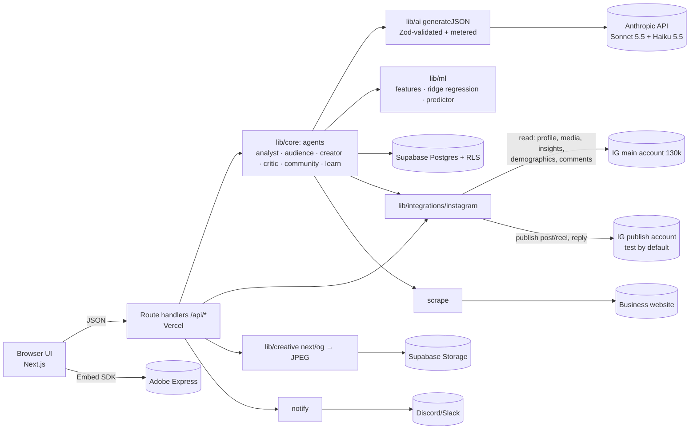

# Loopwise: under the hood

> Predict before you post. Learn after you post.

Every number below was measured during the build. The two numbers still to fill in on the account itself are marked **TBD (live)**.

## Architecture

- **Stack:** one Next.js 15 app on Vercel, with TypeScript end to end.
- **Contracts:** every API payload, LLM output and DB row is validated against the shared Zod contracts in `src/lib/contracts.ts`.
- **Data access:** only the server reads the database, using the service role. RLS is on with no policies, so the database rejects every other client.
- **Fallback modes:** `AI_PROVIDER=mock`, `IG_DATA_MODE=mock` and `PUBLISH_MODE=mock` let the full loop run with no tokens and no accounts. An unconfigured deploy defaults to all three.

## The five agents

| Agent | Input | Output | Model |
|---|---|---|---|
| **Analyst** | Real posts and reels, insights, metrics | Format performance, best hours, the trained model, 3–5 learnings that cite numbers | Sonnet 5.5 (learnings); the rest is computed in code |
| **Audience** | Bio, top 15 and bottom 10 posts, demographics, 60 comment texts | Brand DNA, a specific niche, content pillars, 4 personas grounded in the data | Sonnet 5.5 |
| **Creator** | DNA, audience summary, personas, latest 6 learnings, brief | Post, carousel and reel variants; each reel gets a hook, scenes, on-screen text, audio direction, editing notes and a TikTok note | Sonnet 5.5 |
| **Critic** | Personas × variants | A synthetic focus group: every persona reacts to every variant in **one** call | Haiku 5.5 |
| **Community** | Up to 40 comment texts (no usernames) | Sentiment, topic, question flag, reply drafts, 3 loyalty ideas | Haiku 5.5 |

**Ranking:**
- **Panel score:** Σ (persona share × stop score × 10).
- **Final rank:** 0.5 × normalised panel score + 0.5 × normalised predicted engagement rate (ER).

**Numbers stay in code:** the LLM never computes engagement rates, shares, best hours or format performance; code does, and the LLM only interprets them.

## The ML model

- **Target:** log(ER + 0.001), because ER is heavily skewed. Predictions are transformed back and clamped to 0.2%–30%.
- **Features (10):**
  - intercept
  - panel score
  - caption length
  - hashtag count, plus a flag for more than 10 hashtags
  - question flag and emoji flag
  - reel flag and carousel flag
  - evening post (17:00–22:00)
- **Method:** ridge regression, (XᵀX + λI)⁻¹Xᵀy with λ = 0.1, solved by Gaussian elimination. It has no ML dependency.
- **Training:** the model is trained on the account's own history. It needs at least 8 posts with insights; below that it uses prior weights.
- **Tests:** unit tests check that the model recovers known weights (R² > 0.9), that predictions are clamped, that features are deterministic, and that the simulator is reproducible with a seed.
- **R² on @ironcladwind:** **TBD (live)**. R² is in-sample, on log(ER).
  - It was 0.83 on mock data. That is not a result and is not used in the pitch.
- **Learning loop:**
  1. New metrics arrive.
  2. The model is retrained.
  3. The Analyst writes learnings that cite those numbers.
  4. The Creator lists the learnings it applied.
  - **Measured:** after one learning run, all 4 new variants cited real learning ids (13 links, 0 invented).

## Model routing: measured, not assumed

The campaign route (Creator, then Critic) started at **57 s** with both agents on Sonnet 5.5. We then made three changes:

1. Moved the Critic to Haiku 5.5. This is a classification-style task, and its call dropped from 22.2 s to 8.1 s.
2. Sent the Creator an audience summary instead of the full profile.
3. Turned off extended thinking for these JSON calls.

| Run | Creator | Critic | Route | Cost* |
|---|---|---|---|---|
| Both on Sonnet 5.5 | 33.8 s | 22.2 s | **57.0 s** | €0.064 |
| Critic on Haiku 5.5, trimmed prompt | 33.9 s | 8.1 s | **44.2 s** | €0.040 |
| Same, with 5 learnings in context | 29.8 s | 7.9 s | **38.7 s** | €0.036 |

\* Cost is recomputed from the measured tokens at today's prices.

**Other measured calls** (real model, mock Instagram data):

| Call | Model | Latency | Cost |
|---|---|---|---|
| Instagram import, Audience agent | Sonnet | 25 s | €0.036 |
| Learning loop | Sonnet | 8.9 s | €0.016 |
| Community agent, 20 comments | Haiku | 12.3 s | €0.0012 |
| Website onboarding | Sonnet | 19.9 s | €0.021 |

## Engineering safeguards

- **Validated LLM output:** every call goes through `generateJSON`, which validates with Zod, retries once with the validation error, and throws a typed error. All attempts share a 50 s budget. A refusal or an API error returns 502, never invented data.
- **Metering:** every AI call is written to `ai_usage` with its tokens, cost and latency. A metering failure never breaks the request.
- **Idempotent import:** publications are keyed by Instagram id. Re-importing updates metrics and never duplicates posts.
- **Error handling:** errors follow the `ApiError` contract (400, 404, 422, 502 or 500). Internal error details stay in the server log.
- **Scraper safety (SSRF-safe):** it accepts only http and https. It blocks private, loopback, link-local and metadata addresses, both after DNS resolution and on every redirect (at most 3). Pages are capped at 2 MB and 10 s.
- **Tests:** 67 unit tests, plus `scripts/smoke.ts`, which runs the whole API loop and reports PASS or FAIL with timings.

## Data and privacy rules

- **Owner's data only:** live data comes only from the account owner's own authorised token. Nothing is scraped from Instagram.
- **No commenter identities:** usernames never leave Instagram's response. The snapshot contract has no username field, and the LLM receives only comment text.
- **Labelled sources:** simulated and seeded numbers are labelled `simulated` or `seeded`, never `live`. Mock imports are stored as `seeded`.
- **Safe publishing:** publishing goes to a separate test account by default. Posting to the 130k account needs both `account: "main"` and `confirmMainAccount: true`, behind a confirm dialog.
- **No secrets in the repo:** server keys never get a `NEXT_PUBLIC_` prefix.

## Cost vs value

**Our cost: measured.** Prices come from Anthropic's pricing page (checked 2026-11-07) at 1 USD = 0.87 EUR:

| Model | Input (EUR / MTok) | Output (EUR / MTok) |
|---|---|---|
| Sonnet 5.5 | 1.74 | 8.70 |
| Haiku 5.5 | 0.087 | 0.435 |

| Item | Measured cost |
|---|---|
| One campaign (4 variants incl. reel scripts, plus the focus group) | **€0.036–0.040** |
| Instagram import and audience analysis | €0.036 |
| Learning run | €0.016 |
| Community run | €0.001 |

**Customer value: from explicit, editable assumptions.**
- **Time saved:** about 2 h of manual work per campaign at €20/h ≈ **€40 per campaign**. That is roughly **1,000×** the measured AI cost.
- **Starter plan (€19/mo, 20 campaigns):** about €0.80 of AI cost per month, so the gross margin is above 90% before infrastructure.

**What we did to keep costs down:**
- one call for the whole focus group
- capped inputs (300-character captions, 60 comments, 6 learnings)
- a cheaper model for scoring and classification
- numbers computed in code

The ROI meter in the app shows these figures live from `ai_usage`.
